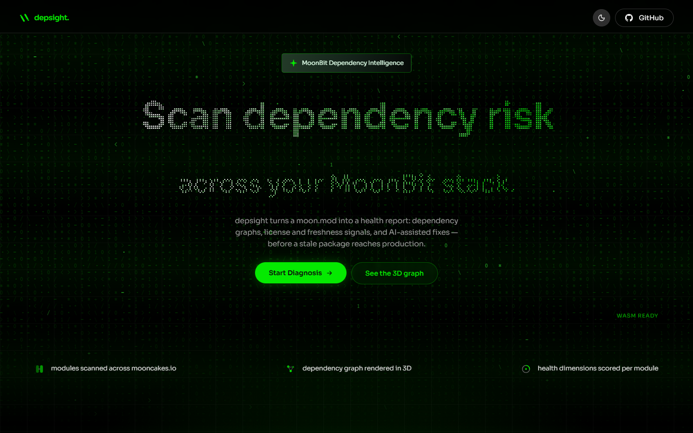
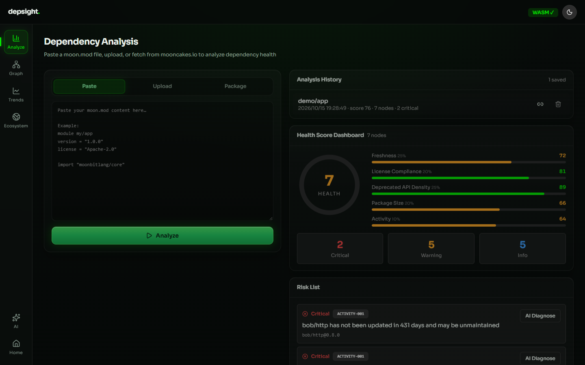
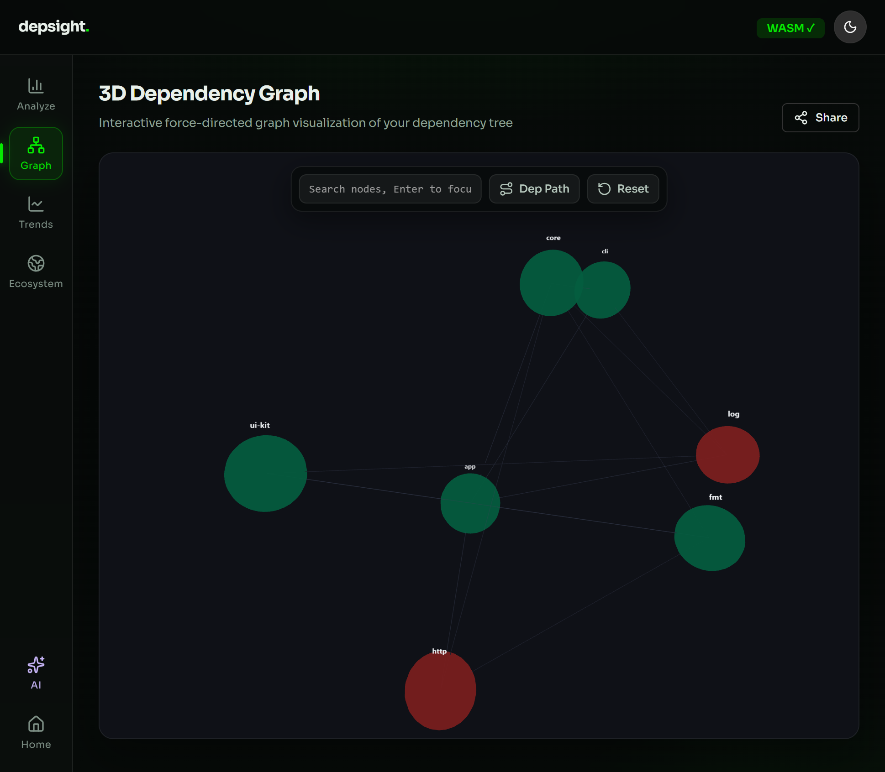
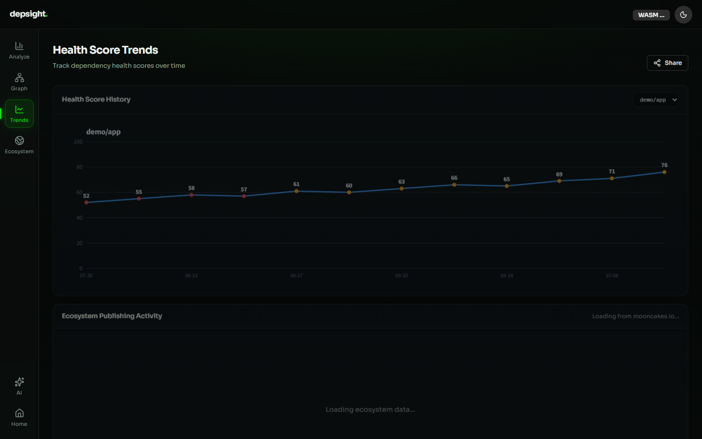
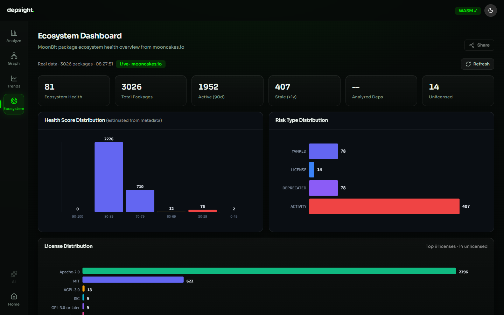

# Depsight

Dependency-health analysis for MoonBit — surface risky dependencies before they reach production.

Live demo: [depsight.xruoyu.xyz](https://depsight.xruoyu.xyz/)



## Product preview

| Analysis dashboard (score + risk list)  | 3D dependency graph (size / health mapping) |
| --------------------------------------- | ------------------------------------------- |
|  |           |

| Health score trends                  | Ecosystem dashboard (full mooncakes.io stats) |
| ------------------------------------ | --------------------------------------------- |
|  |     |

## Features

| Module                  | Description                                                                                                                         |
| ----------------------- | ----------------------------------------------------------------------------------------------------------------------------------- |
| **Dependency analysis** | Paste `moon.mod` text, upload a file, or type `name@version`; the full dependency graph is expanded automatically                   |
| **Health scoring**      | 0–100 composite score, five weighted dimensions: freshness 25%, compliance 20%, deprecated density 25%, size 20%, activity 10%      |
| **Risk diagnostics**    | YANKED-001 / OUTDATED-001 / LICENSE-001 / DEPRECATED-001 / SIZE-001 / ACTIVITY-001 / DUP-001 / CYCLE-001                            |
| **3D graph**            | three.js force-directed layout; node size encodes footprint, color encodes health; search-to-focus and dependency-path highlighting |
| **Trend tracking**      | Historical scores kept in localStorage, rendered as a hand-drawn Canvas line chart                                                  |
| **Ecosystem dashboard** | Full-catalog analysis of mooncakes.io: license distribution, active/stale package stats, risk-type counts                           |
| **AI diagnostics**      | Any OpenAI-compatible API: single-risk diagnosis / full report / fix-PR draft; built-in rule engine fallback without an API key     |
| **Shareable results**   | Results encoded into a `#share=<payload>` URL; recipients restore the view without re-analysis                                      |

## Architecture

```
┌─────────────────────────────────────────┐
│  React 19 + TypeScript + Vite + Tailwind │
│  three.js / OGL — visualization layer    │
├─────────────────────────────────────────┤
│  MoonBit WASM (wasm-gc + js-string)      │
│  ↓ auto-fallback to the pure TS engine   │
│    (identical behavior) on failure       │
├─────────────────────────────────────────┤
│  Vercel Serverless Functions             │
│  /api/download/*   /api/health           │
├─────────────────────────────────────────┤
│  mooncakes.io API (open CORS, browser-   │
│  direct) + ZIP downloads (Vite proxy     │
│  in dev)                                 │
└─────────────────────────────────────────┘
```

### Analysis engine

The core engine is written in **MoonBit** and compiled to **WASM** (wasm-gc + JS string builtins), kept behaviorally identical to the pure TypeScript fallback.

- Engine source: `../moonbit/main/*.mbt`
- WASM artifact: `public/depsight.wasm`
- TS fallback: `src/lib/analyzer.ts` (~1,400 lines, aligned with the WASM logic line by line)

**Bridging strategy**:

- `version()` contract gate: WASM is disabled automatically on version mismatch
- Circuit breaker: degrades to the TS engine after 3 consecutive failures
- Oversized-input guard: context JSON > 8 MB bypasses WASM
- Contract tests: `moon test` in `../moonbit` and `npm test` here assert identical outputs for shared fixtures

### API endpoints

| Endpoint                           | Description                                             |
| ---------------------------------- | ------------------------------------------------------- |
| `GET /api/health`                  | Health check `{ ok, service, version, ts }`             |
| `GET /api/download/:name/:version` | Proxied package ZIP download (same-origin, avoids CORS) |

> The module list and manifests are fetched browser-direct from `https://mooncakes.io/api/v0` (officially open CORS), so no server-side proxy is needed for them.

## Local development

```bash
npm install
npm run dev        # dev server
npm run build      # production build
npm test           # run tests
npm run lint       # lint
```

## Deployment

### Vercel (recommended)

```bash
npm i -g vercel
vercel --prod
```

`vercel.json` is preconfigured:

- `/assets/*` → `max-age=31536000, immutable`
- WASM / media → 1-day cache
- `/api/*` → `no-store`
- SPA fallback rewrite → `/index.html`

### Environment variables

None required. The AI diagnostics API key is configured by each user in browser localStorage.

## Data flow

```
moon.mod text
    ↓
fetcher.ts — mooncakes.io client (multi-layer cache)
    ↓
BFS expansion of transitive deps → AnalysisContext
    ↓
WASM / TS engine analysis
    ↓
Dashboard (score) + RiskList (diagnostics) + GraphView (3D)
```

## Caching strategy

| Data                     | Storage        | TTL        |
| ------------------------ | -------------- | ---------- |
| Module list              | sessionStorage | 30 minutes |
| manifest / mod / LICENSE | localStorage   | 24 hours   |
| Analysis history         | localStorage   | 20 entries |
| Theme / AI settings      | localStorage   | permanent  |

## Tech stack

| Layer           | Technology                                        |
| --------------- | ------------------------------------------------- |
| Frontend        | React 19, TypeScript ~6.0, Vite 8, Tailwind CSS 3 |
| Visualization   | three.js, OGL, Canvas                             |
| Analysis engine | MoonBit → WASM (wasm-gc)                          |
| Backend         | Vercel Serverless Functions                       |
| Data source     | mooncakes.io API + ZIP packages                   |
| Deployment      | Vercel (Serverless Functions)                     |

## License

MIT
