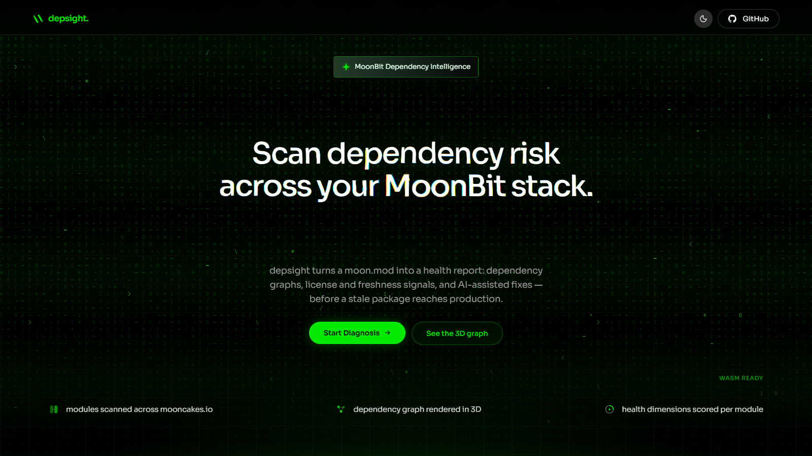

# Depsight

MoonBit 依赖健康分析工具 — 在过期依赖进入生产环境前，帮你发现风险。

在线体验: [depsight.xruoyu.xyz](https://depsight.xruoyu.xyz/)



## 功能

| 模块 | 说明 |
|------|------|
| **依赖分析** | 粘贴 `moon.mod` 文本、上传文件、或输入包名@版本，自动展开完整依赖图 |
| **健康评分** | 0-100 综合评分，五维度加权：新鲜度 25%、合规 20%、废弃密度 25%、体积 20%、活跃度 10% |
| **风险诊断** | YANKED-001 / OUTDATED-001 / LICENSE-001 / DEPRECATED-001 / SIZE-001 / ACTIVITY-001 / DUP-001 / CYCLE-001 |
| **3D 依赖图** | three.js 力导向图，节点大小映射体积，颜色映射健康分，支持搜索聚焦与依赖路径高亮 |
| **趋势追踪** | localStorage 记录历史评分变化，Canvas 手绘折线图 |
| **生态看板** | mooncakes.io 全量包分析：许可证分布、活跃/停滞包统计、风险类型计数 |
| **AI 诊断** | 接入任意 OpenAI 兼容 API，单风险诊断 / 全量报告 / 生成修复 PR；无 API 时内置规则引擎降级 |
| **结果分享** | 分析结果编码为 `#share=<payload>` URL，接收方无需重新分析 |

## 技术架构

```
┌─────────────────────────────────────────┐
│  React 19 + TypeScript + Vite + Tailwind │
│  three.js / OGL / Spline — 可视化层      │
├─────────────────────────────────────────┤
│  MoonBit WASM (wasm-gc + js-string)      │
│  ↓ 失败时自动回退到纯 TS 实现（行为一致）  │
├─────────────────────────────────────────┤
│  Vercel Serverless Functions             │
│  /api/modules  /api/download/*  /api/health│
├─────────────────────────────────────────┤
│  mooncakes.io API + 下载 ZIP 包           │
└─────────────────────────────────────────┘
```

### 分析引擎

核心引擎用 **MoonBit** 编写，编译为 **WASM**（wasm-gc + JS String Builtins），与纯 TypeScript 回退实现保持行为完全一致。

- 引擎源码: `d:\MoonStep\moonbit\main\*.mbt`
- WASM 产物: `public/depsight.wasm`
- TS 回退: `src/lib/analyzer.ts`（约 1400 行，逐行对齐 WASM 逻辑）

**桥接策略**：
- `version()` 契约门：版本不符自动禁用 WASM
- 连续失败熔断：3 次失败后自动降级
- 超大输入防护：context JSON > 8MB 跳过 WASM

### API 端点

| 端点 | 说明 |
|------|------|
| `GET /api/modules` | 代理 mooncakes.io 模块列表 |
| `GET /api/modules/:name` | 代理单包 manifest |
| `GET /api/download/:name/:version.zip` | 代理下载包 ZIP |
| `GET /api/health` | 健康检查 `{ ok, service, version, ts }` |

## 本地开发

```bash
npm install
npm run dev        # 开发服务器
npm run build      # 生产构建
npm test           # 运行测试
npm run lint       # 代码检查
```

## 部署

### Vercel（推荐）

```bash
npm i -g vercel
vercel --prod
```

`vercel.json` 已配置：
- `/assets/*` → `max-age=31536000, immutable`
- WASM/媒体 → 1 天缓存
- `/api/*` → `no-store`
- SPA fallback rewrite → `/index.html`

### 环境变量

无需环境变量。AI 诊断的 API Key 由用户在浏览器 localStorage 中自行配置。

## 数据流

```
moon.mod 文本
    ↓
fetcher.ts — mooncakes.io 客户端（多层缓存）
    ↓
BFS 展开传递依赖 → AnalysisContext
    ↓
WASM / TS 引擎分析
    ↓
Dashboard (评分) + RiskList (诊断) + GraphView (3D图)
```

## 缓存策略

| 数据 | 存储 | TTL |
|------|------|-----|
| 模块列表 | sessionStorage | 30 分钟 |
| manifest / mod / LICENSE | localStorage | 24 小时 |
| 分析历史 | localStorage | 20 条 |
| 主题 / AI 设置 | localStorage | 永久 |

## 技术栈

| 层 | 技术 |
|---|------|
| 前端 | React 19, TypeScript ~6.0, Vite 8, Tailwind CSS 3 |
| 可视化 | three.js, OGL, Spline, Canvas |
| 分析引擎 | MoonBit → WASM (wasm-gc) |
| 后端 | Vercel Serverless Functions |
| 数据源 | mooncakes.io API + ZIP 包 |
| 部署 | Vercel / Cloudflare Pages |

## License

MIT
